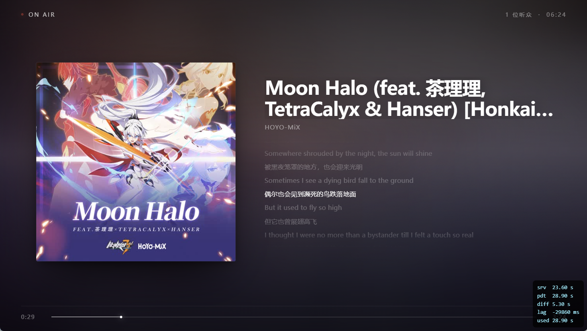

# Kokona-Radio

不间断网页电台。服务器端持续播放音乐，所有听众听到同一段音频，进度完全同步。支持网页播放和 foobar2000 等外部播放器收听



## 特性

- 所有听众进度一致。任何人任何时候接入，听到的都是服务器当前正在播的位置
- 歌词与进度精确对齐。每首歌的起点在切歌那一刻从播放时钟直接量出，服务连续跑几十小时也不会累积偏移
- 听众离开、刷新，服务器照常播放，进度不重置
- 兼容 `.m3u8`，fb2k / VLC 可直接打开
- **Icecast 兼容统计端点** `/status-json.xsl`
- 元数据全部来自音频文件标签。标题、艺术家、专辑、封面、歌词都不需要文件命名约定，歌词优先读内嵌字段，回退到同名 `.lrc`
- **响度归一化**。后台用 EBU R128 测一遍整库的真实响度，播放时补一个静态增益，让不同专辑之间的音量不再一大一小
- 控制面板。路径和 token 均可配置，支持上一首 / 下一首、查看待播队列、已播历史、在线听众
- 系统通知。支持 `<br>`、`<b>`、`<strong>`、`<i>`语法并通过控制面板编辑
- PWA 支持
- Media Session 支持。手机锁屏、耳机线控、系统媒体卡片能显示曲目信息并暂停/继续

## 架构

```
音频文件 --(子 ffmpeg, -re)--> 裸 PCM --(FIFO)--> 主 ffmpeg --(HLS)--> 客户端
                                                    |
                                                    +--> m3u8 + ts 切片
```

- 主 ffmpeg 从命名管道读 PCM，输出 HLS
- 切歌时只更换往 FIFO 写数据的子 ffmpeg。主 ffmpeg 无感，切片序号连续。

## 最小配置要求

- 双核CPU
- Linux

## 依赖

- Node.js 18+
- ffmpeg 与 ffprobe（4.3+）

## 部署

## 克隆

```bash
git clone https://github.com/hsushjk/kokona-radio.git
cd kokona-radio
```

## 配置 config.json ，存放音乐到 music

参照[配置说明](#配置说明) 或 `config.example.json`

## 生成 PWA（可选）

```bash
cd public
chmod +x generate-pwa.sh
./generate-pwa.sh
```

按提示输入标题、描述、简称、主题色、背景色，回车使用默认值。脚本会生成 `index.json`、`manifest.json`

## 启动后端

```
node server.js
# 或自行用喜欢的方法常驻
```

## Nginx 反代

支持反代，但要注意：

- `proxy_buffering off` 必须加。HLS 是流式切片，缓冲会破坏on air体验。
- 如果使用 Cloudflare，请关闭 Rocket Loader 和 Auto Minify（JS / CSS / HTML 全部关掉）。这两项会改写页面内联脚本，可能导致控制面板按钮无响应。建议为 `面板路径` 添加 Page Rule：Cache Level 设为 Bypass，Disable Performance，Disable Apps。本项目已经尽量避免这种情况并尽量兼容

## 缓存策略

服务端按资源类型分别下发 `Cache-Control`，方便 CDN 分层缓存：

| 路径 | Cache-Control |
|---|---|
| `/static/*`、顶层 `.js/.css/.png/...` | `public, max-age=31536000, immutable` |
| `/stream/*.ts` | `public, max-age=31536000, immutable` |
| `/cover/:id`、`/cover-blur/:id` | `public, max-age=86400`（带 `ETag`） |
| `/`、`/index.html`、`*.json`、`*.txt` | `no-cache`（带 `ETag`，可 304） |
| `/stream/stream.m3u8` | `no-cache`（服务端内存缓存 250ms，回源压力小） |
| `/api/*`、`/healthz`、`/status-json.xsl` | `no-cache`（不带 ETag，每次回源取最新） |

切片文件名带递增序号且内容不可变，所以可以长缓存；m3u8 是实时的，必须每次回源。

## 健康检查

`GET /healthz` 返回（无需鉴权）：

```json
{"ok":true,"healthy":true,"uptime":1234,"mainFfmpeg":true,"ffmpegRestarts":0,
 "writeStalls":0,"lastStallMs":0,"librarySize":861,"listeners":2,
 "current":"a1b2c3d4e5f6a7b8","rssMB":78,"loudness":{"active":true,"done":12,"total":861}}
```

| 字段 | 含义 |
| --- | --- |
| `ok` | 后端进程存活 |
| `healthy` | 音频链路健康（主编码器在跑）。`ok` 为 true 但 `healthy` 为 false = 进程在、声音没了 |
| `uptime` | 本进程已运行秒数，重启即归零 |
| `mainFfmpeg` | 主编码器进程是否存在 |
| `librarySize` | 当前曲库曲目数 |
| `listeners` | 在线听众人数，与 `/api/status` 同源 |
| `current` | 正在播的曲目 id，没有则为 `null` |
| `ffmpegRestarts` | 主编码器累计重启次数。**持续增长说明在崩溃循环** |
| `writeStalls` | 写 FIFO 被背压卡住超过 500ms 的次数。增长说明主编码器跟不上实时，通常伴随掉音 |
| `lastStallMs` | 上面那次具体卡了多久 |
| `rssMB` | 进程常驻内存。长期单调上涨就是内存泄漏 |
| `loudness` | 响度补测进度，补测完 `active` 变 `false` |

此接口也内嵌在控制面板里

## Icecast 兼容统计

`GET /status-json.xsl`（别名 `/status-json`）返回 Icecast 2 的 `icestats` 结构，无需鉴权：

```json
{
  "icestats": {
    "admin": "Kokona-Radio",
    "host": "radio.kokona.org",
    "location": "",
    "server_id": "Kokona-Radio",
    "server_start": "Fri, 20 Nov 2026 12:04:16 GMT",
    "server_start_iso8601": "2026-11-20T12:04:16.000Z",
    "source": {
      "audio_info": "bitrate=192;samplerate=44100;channels=2",
      "bitrate": 192,
      "genre": "",
      "ice-bitrate": 192,
      "listener_peak": 2,
      "listeners": 2,
      "server_description": "",
      "server_name": "Kokona-Radio",
      "server_type": "audio/mpeg",
      "server_url": "",
      "source_ip": "127.0.0.1",
      "stream_start": "Fri, 20 Nov 2026 12:04:16 GMT",
      "stream_start_iso8601": "2026-11-20T12:04:16.000Z",
      "title": "AWOLNATION - Sail"
    }
  }
}
```

| 字段 | 说明 |
|---|---|
| `icestats.host` | 取自请求头 `Host`，反代后即面板看到的域名 |
| `icestats.server_start` / `server_start_iso8601` | 本进程启动时刻，不是开播时刻 |
| `source.listeners` / `listener_peak` | 当前在线听众数，与 `/api/status` 的 `listeners` 同源 |
| `source.bitrate` / `ice-bitrate` | 由 `bitrate` 推出的整数，单位 kbps |
| `source.audio_info` | `bitrate=…;samplerate=…;channels=2`，采样率取 `sampleRate` |
| `source.title` | `艺术家 - 曲名`，无艺术家时只有曲名。每次请求现算，不是 ICY 元数据 |
| `source.stream_start` / `stream_start_iso8601` | 当前曲目开始时刻 |
| `source.server_type` | 固定 `audio/mpeg`，只为兼容读这个字段的脚本 |
| `source` | 没有在播曲目时为 `[]`（空数组），与 Icecast 行为一致 |

- 这个接口是给监控、脚本和「判断这是不是一个网络电台」的工具做兼容用的，与音频传输方式无关。本站走 HLS，不提供 ICY 直推流，`server_type` 只是名义值
- 只读、不触达曲库与 ffmpeg，可以和 `/healthz` 一起交给监控轮询
- 外部播放器（fb2k / VLC）读的是 ICY 的 `StreamTitle`，不是这个接口，所以它不会让播放器显示曲名

## 配置说明

`config.json`

```json
{
  "port": 3003,
  "musicDir": "/opt/radio/music",
  "hlsDir": "/opt/radio/hls",
  "publicDir": "/www/wwwroot/radio",
  "fifoPath": "/tmp/radio-pcm.fifo",
  "ffmpegPath": "/usr/bin/ffmpeg",
  "ffprobePath": "/usr/bin/ffprobe",
  "cachePath": "cache/cache.json",
  "noticePath": "/opt/radio/notice.json",
  "bitrate": "192k",
  "sampleRate": 44100,
  "hlsTime": 2,
  "hlsListSize": 6,
  "hlsStartNumberSource": "epoch",
  "liveSyncDurationCount": 2,
  "streamDelay": 0,
  "playlistCacheMs": 250,
  "shuffle": true,
  "scanInterval": 300000,
  "coverMaxWidth": 512,
  "coverCacheEntries": 64,
  "coverCacheBytes": 33554432,
  "coverTimeoutMs": 8000,
  "loudnessEnabled": true,
  "loudnessTarget": -16,
  "loudnessMaxGain": 12,
  "controlPath": "control",
  "controlToken": "1234567890passwd"
}
```

> `controlToken` 必须自己填，长度至少 16 位。留空则控制面板整个禁用。
> `config.example.json` 里的 token 只是占位示例；仓库不再附带 `config.json`，直接照抄示例上线等于公开凭据。

| 字段 | 说明 |
|---|---|
| `port` | Node 服务监听端口 |
| `musicDir` | 音乐目录，递归扫描，支持 mp3 / flac / m4a / wav / ogg / opus / aac / wma / aiff / ape |
| `hlsDir` | HLS 切片输出目录，每次启动清空 |
| `publicDir` | 前端静态文件目录 |
| `fifoPath` | PCM 管道路径 |
| `ffmpegPath` / `ffprobePath` | 二进制绝对路径；只写 `ffmpeg` / `ffprobe` 则走 PATH |
| `cachePath` | 元数据缓存文件。键为 `路径\|mtime\|大小`，命中即跳过 ffprobe。目录或文件不存在时自动创建；删掉它只会让下次扫描变慢 |
| `noticePath` | 通知数据文件路径。目录或文件不存在时自动创建 |
| `bitrate` | AAC 输出码率，建议 128k 至 256k |
| `sampleRate` | 输出采样率 |
| `hlsTime` | 单个切片秒数。起播延迟 ≈ `liveSyncDurationCount × hlsTime`，所以切片越短起播越快，但每秒要处理的文件也越多 |
| `hlsListSize` | m3u8 保留的切片数，窗口长度 ≈ `hlsListSize × hlsTime`（默认 6×2 = 12 秒）。它**不决定起播延迟**（那由 `liveSyncDurationCount` 决定），只决定客户端能往回退多远：卡顿、切后台、暂停之后还能不能接着放 |
| `hlsStartNumberSource` | 切片序号来源，默认 `epoch`（Unix 时间戳）。重启后序号单调递增，客户端不会因为序号回退而集体 404。需要 ffmpeg 4.3+ |
| `liveSyncDurationCount` | 观众起播时落后直播边缘几个切片，默认 2。必须和前端 `index.html` 里 hls.js 的同名参数一致，否则服务端算出的播放点会和浏览器实际听到的位置错开。前端另有 `liveMaxLatencyDurationCount`（默认 `lsdc + 2`）决定「落后超过多少就强制追平」，它只影响客户端行为，与对时无关 |
| `streamDelay` | 额外的保险，单位秒，默认 0。**正常不需要改**——真实播放位置由 m3u8 的 `PROGRAM-DATE-TIME` 推算。只在观测到「歌词稳定偏早」时才加一点 |
| `playlistCacheMs` | m3u8 内存缓存时间，默认 250。越小越实时、回源越多 |
| `shuffle` | 是否每轮打乱曲库 |
| `scanInterval` | 曲库重扫间隔，毫秒，默认 300000（5 分钟）。未变更的文件直接读缓存 |
| `coverMaxWidth` | 封面抽出宽度，默认 512 |
| `coverCacheEntries` | 封面内存缓存条数（LRU），默认 64 |
| `coverCacheBytes` | 封面内存缓存字节上限，默认 33554432（32 MB） |
| `coverTimeoutMs` | 抽封面 / 量响度超时，默认 8000 |
| `loudnessEnabled` | 是否启用响度归一化，默认 `true`。关掉就完全不测量、不加增益 |
| `loudnessTarget` | 目标积分响度（LUFS），默认 -16。播客/音乐常见 -16 ~ -14 |
| `loudnessMaxGain` | 单曲最大增益（dB），默认 12。防止把老音频拉满 |
| `controlPath` | 控制面板路径。为空则禁用控制功能 |
| `controlToken` | 控制面板 token。至少 16 位。为空则禁用控制功能 |

## 延迟对齐

播放进度对齐**不需要手工调参**。

服务器让 ffmpeg 给每个切片打上 `EXT-X-PROGRAM-DATE-TIME`，再用它反推客户端此刻在播哪一段
音频；前端拿到 `frag.programDateTime` 后自己算片内进度，完全不依赖浏览器和服务器之间的时钟。

每首歌的起点（`originPdt`）在**切歌那一刻**直接从播放时钟量出来：取最后一片的结束时间戳，
加上它写完到现在流逝的时间，再补一个固定的起播延迟（80 ms 静音垫 + 子 ffmpeg 冷启动，
合计约 280 ms）。前端用「正在播的切片时间 − 这个起点」得到片内进度，**两端都是播放时钟，
相减时把播放时钟相对墙上时钟的漂移整个抵掉了**，服务连续跑几十小时也不会越拖越偏。

量不到 m3u8 时会退回旧算法（墙上时刻 + 实测漂移中位数），精度差一个漂移量但不会崩。
前端还有一道保险：算出来的进度若小于 -20 秒、或超过曲长 60 秒（服务重启时新旧进程的数据
混在一起会出现这种离谱值），直接弃用该值，退回服务端兜底进度。

`streamDelay` 只影响服务端那个**兜底值**，正常填 `0`。想让歌词比声音晚一点就填正数秒，
比如 `0.3` 晚 300 ms。

浏览器打开 `?debug=1` 会在右下角显示 `srv / pdt / diff / lag / used`，并把采样上报到
`/api/debug/report`，排查时直接看 `/api/debug` 即可。

| 字段 | 说明 |
|---|---|
| `srv` | 服务端推算值（平滑公式，不含 PDT，用作兜底） |
| `pdt` | 用 PDT 算出来的精确值，滚歌词实际用的是它 |
| `diff` | 上面两个之差，正常情况应在 1 秒内小幅摆动 |
| `lag` | `Date.now()` 与播放时钟的原始差值。混了「链路延迟」和「播放时钟漂移」，**看走势不看绝对值**：稳定 = 正常，持续变大 = 在累积落后 |
| `used` | 最终用在界面上的值；`pdt` 显示 `(无)` 表示走的是原生 HLS 分支（Safari），退化到兜底值 |

## 控制面板

配置 `controlPath` 和 `controlToken` 后，访问 `https://example.com/<controlPath>` 打开

面板基础功能：

- 上一首：从已播历史中弹出最近一首，重新播放
- 下一首：立即切换
- 待播队列、已播历史、在线听众：分页查看（每页条数可在面板里调），已播历史最多保留最近 500 首
- 听众统计：按 sid 或 IP，20 秒无请求判定掉线

鉴权通过 `X-Ctrl-Token` 请求头传递，使用 `crypto.timingSafeEqual` 比较。token 长度不足 16 位则整个控制功能禁用

`controlPath` 也配置成不易猜测的复杂字符串，避免扫描爆破

## 系统通知

通知文本存储在 `noticePath` 指定的 JSON 文件中，格式：

```json
{
  "text": "熙熙攘攘<br>我们的城市</b>。",
  "updatedAt": 1790773960198
}
```

- `text` 为空字符串或文件不存在时，前端不显示通知框
- 通知只在启动时读取一次，手动编辑文件后需要重启服务才生效
- 通过控制面板保存则立即生效
- 只放行 `<br>`、`<b>`、`<strong>`、`<i>` 四种标签，其余全部转义为纯文本
- 文本中的换行符自动转为 `<br>`
- 通知在进入电台前的入场页显示，进入后每 2 秒轮询更新

## PWA

执行 `public/generate-pwa.sh` 生成 PWA 配置文件。index.html加载时读取 `index.json` 动态设置标题、主题色、注册 service worker。浏览器地址栏一般会自动出现安装图标，无需在页面内添加安装按钮。

## 外部播放器

foobar2000 或 VLC 可直接打开：

```
https://example.com/stream/stream.m3u8
```

## 常见问题

### 刚进网页电台的前几秒播放速度微快

客户端正在同步播放进度

### 控制板能打开，但按钮无响应

暂时停用 Cloudflare 的改写优化功能试试

### UI 与声音不同步

正常情况不用管，服务端用 `PROGRAM-DATE-TIME` 自动对齐。如果确实偏了，先用 `?debug=1` 看一眼
`diff`（界面用的 pdt 与服务端兜底值之差）和 `lag`（是否在持续变大），再决定要不要给
`streamDelay` 加一点点。`streamDelay` 只影响兜底值，`pdt` 正常时改它不会改变歌词位置。

### 连续听一两个小时后，进度会轻微跳一下

这是音频时间线比真实时间快造成的，不是 bug。子 ffmpeg 的 `-re` 只做开环节流，实测整条链路
每秒产出的音频比真实时间多 0.1%~0.2%，也就是每小时观众相对播放边缘落后 5~7 秒。前端的
hls.js 配了 `liveSyncDurationCount: 2`（起播落后 2 片 = 4 秒）和 `liveMaxLatencyDurationCount: 8`
（落后 8 片 = 16 秒才强制追平），所以大约每 1.5~2 小时会被温柔地追一次：多数情况是用
`maxLiveSyncPlaybackRate: 1.5` 短暂加速，听感只是轻微变调；极端情况才是跳一下。

想再放宽这个频率，可以继续加大 `liveMaxLatencyDurationCount`，同时把 `config.json` 里的
`hlsListSize` 调大，让 m3u8 窗口（`hlsListSize × hlsTime`）装得下放宽后的落后量。当前部署用的是
`hlsListSize: 20`（40 秒窗口）配 `liveMaxLatencyDurationCount: lsdc + 6`（16 秒阈值），
窗口仍有一倍余量。**`hlsListSize` 本身不降低延迟，也不影响对时**，它只决定窗口有多长。

注意 `liveSyncDurationCount` 不要动，它和 `config.json` 里的同名项必须一致，改了会让服务端
算出的播放点和浏览器实际听到的位置错开。

### 切歌时出现上一首的声音

说明可能是主 ffmpeg 被重启了。检查日志里是否有 `[main-ffmpeg] exit code=`。正常情况下主 ffmpeg 生命周期贯穿整个服务运行，只有崩溃才重启

### 在线听众始终显示 1

如果通过 Nginx 反代，`req.socket.remoteAddress` 一直为 `127.0.0.1`，
本项目已从 `X-Forwarded-For` / `X-Real-IP` 读取真实 IP，并优先按前端生成的 sid 统计。若仍为 1，curl检查是否透传了 `X-Forwarded-For`。

### 歌词封面为空

音乐文件不含元数据，标题回退到文件名（不含扩展名），艺术家为空。建议用音乐标签软件整理后再放入，这里推荐 `Lyrico`

### 歌词不显示

FLAC 与 M4A 的内嵌歌词能被 ffprobe 读取。MP3 的 USLT 帧 ffprobe 读不到，需要把歌词存为与音乐文件同名的 `.lrc`，或转换标签

### 网太弱了，播放起来很卡

http3和2来回切换一下试试，本项目不吃带宽，但怕丢包


## 致谢

- [video-dev/hls.js](https://github.com/video-dev/hls.js)，采用 Apache License 2.0 许可证发布，用于给浏览器补上 HLS 播放能力
